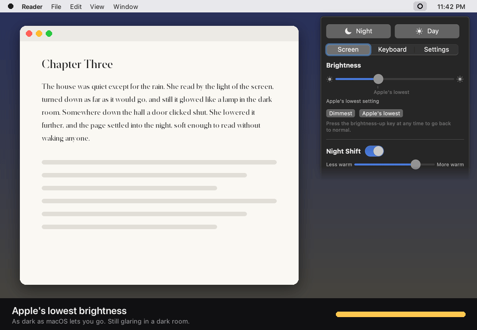
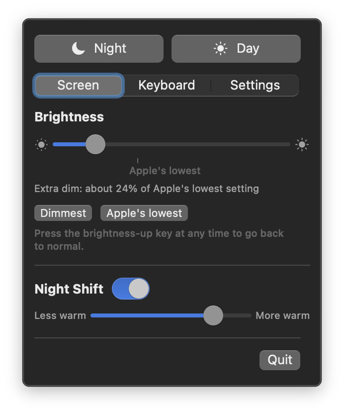
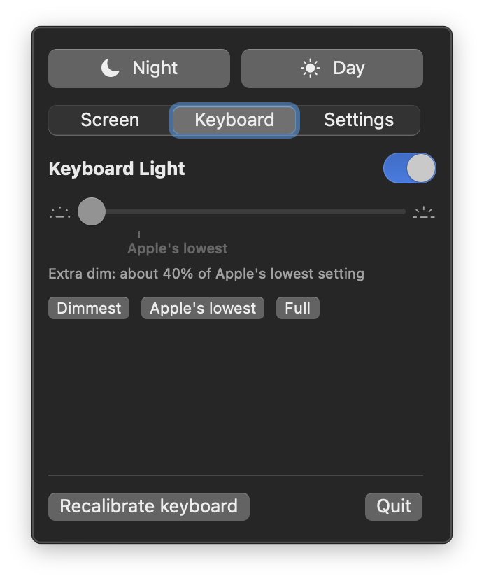
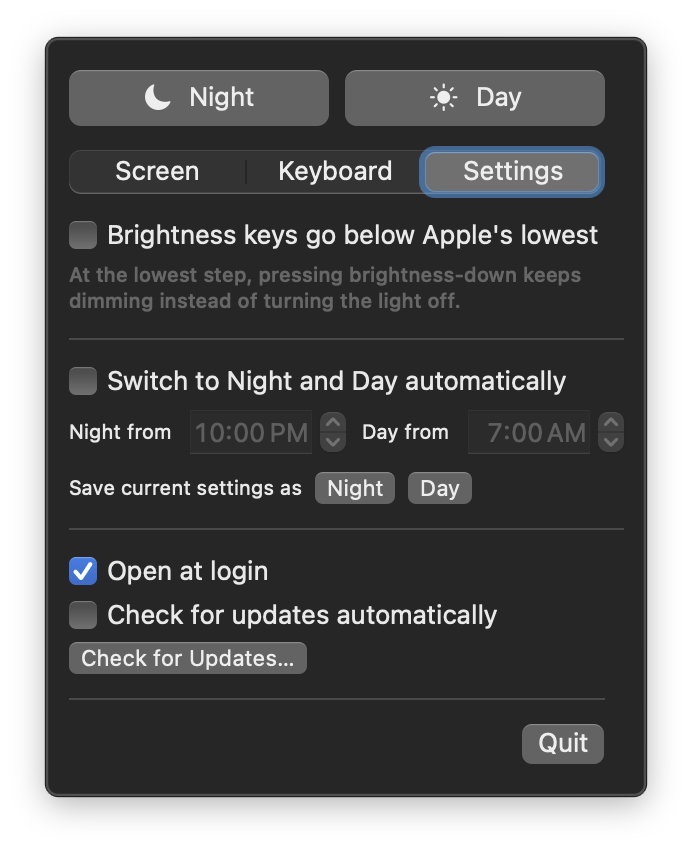

# Even Dimmer

**Your MacBook's lowest brightness is still too bright. Even Dimmer goes lower.**

A free menu bar app that dims your screen and keyboard light below Apple's lowest setting. It's useful for reading in bed, working in a dark room, or a night flight without lighting up the cabin.

   

<p align="center">
  
  <br>
  <sub>Screen recordings can't capture the dimming, so this demo applies it to a mock screen at the levels Even Dimmer measures. The menu is a real screenshot.</sub>
</p>

## What it does

- **🌙 A dimmer screen.** The slider keeps going past Apple's lowest setting, all the way down to barely-there.
- **⌨️ The brightness keys keep going.** At the lowest step, press brightness-down again and the screen gets dimmer instead of going black. A small indicator shows how far you've gone.
- **💡 A dimmer keyboard light.** Go below the lowest key step, or switch it off completely.
- **🌗 Night and Day in one click.** Set screen, keyboard light and Night Shift together. Switch automatically at the times you choose.

To go back to normal at any time, press brightness-up or quit the app. Nothing is changed permanently.

## Install

```bash
brew install --cask isjl/tap/even-dimmer
```

Or [download the latest version](../../releases/latest), unzip it, and drag **Even Dimmer** into Applications.

> **First launch:** Even Dimmer isn't from the App Store, so macOS may say it "can't be opened". Go to **System Settings → Privacy & Security** and click **Open Anyway**. You only need to do this once.

To get new versions automatically, turn on **Check for updates automatically** in Settings. It's off by default.

## Using it

Click the Even Dimmer icon in the menu bar.

- **Screen**: drag left of the **Apple's lowest** mark for extra dim. Night Shift's warmth is right there too.
- **Keyboard**: dim the keyboard light below Apple's lowest step, or switch it off.
- **Settings**: let the brightness keys go lower, switch to Night and Day automatically, save your own presets, and choose whether to check for updates.

| Screen | Keyboard | Settings |
| --- | --- | --- |
|  |  |  |

## Questions

<details>
<summary><b>Is it safe? Can it break my screen?</b></summary>

No. It only uses the same brightness controls macOS uses, just with finer steps. The darkest levels darken the picture in software, and that switches off the moment you quit, press brightness-up, or the app crashes.
</details>

<details>
<summary><b>Why does it ask for Accessibility permission?</b></summary>

Only if you turn on **Brightness keys go below Apple's lowest**. Seeing your brightness key presses requires this permission. Even Dimmer only looks at the brightness keys and never reads anything you type. If you don't use that setting, it never asks.

After an update, macOS sometimes forgets the permission. If Settings shows "Needs Accessibility permission", click **Reset permission** and switch Even Dimmer on again.
</details>

<details>
<summary><b>Does it collect any data?</b></summary>

No. It never connects to the internet unless you check for updates, or turn on automatic update checks (off by default). Even then it only contacts GitHub, to download the update list.
</details>

<details>
<summary><b>Which Macs does it work on?</b></summary>

MacBooks with macOS 13 Ventura or later. It's tested on a MacBook Air (M1), and other Apple Silicon MacBooks should work too. Intel MacBooks are untested.

External monitors aren't supported yet. If it doesn't work on your Mac, please [open an issue](../../issues/new) with your Mac model and macOS version.
</details>

<details>
<summary><b>Why do my screenshots look normal when the screen is extra dim?</b></summary>

The darkest levels are applied on the way to the display, after screenshots are taken. That's expected.
</details>

<details>
<summary><b>How do I uninstall it?</b></summary>

Quit it from its menu, then drag it from Applications to the Trash. If you installed it with Homebrew, run `brew uninstall --cask even-dimmer`.
</details>

## For developers

Build it with `scripts/build-app.sh` (you need Xcode's command line tools). To find out how it reaches below Apple's limits, see [How it works](docs/HOW-IT-WORKS.md). Contributions and reports from other MacBook models are very welcome.

MIT licensed.
